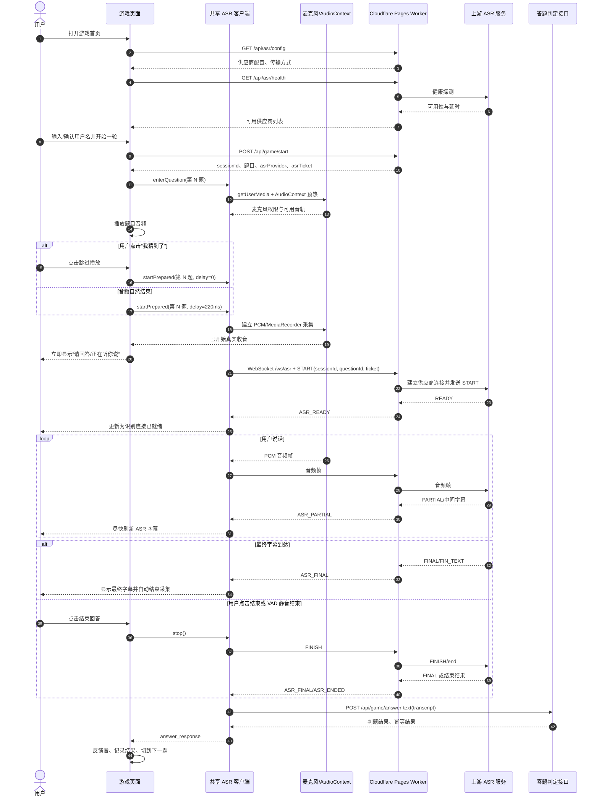
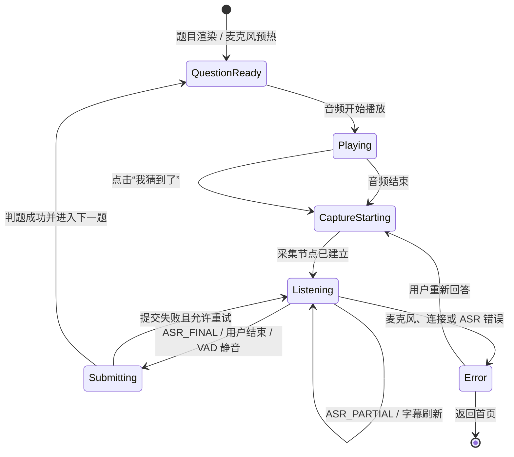

# 语音答题统一时序与代码审计

适用范围：说颜色、声音侦探、中华小曲库。三款游戏通过同一份 `shared/voice-asr-client.js` 处理浏览器采集、字幕、VAD、重试和提交；云端由各自 Pages Worker 负责会话校验、ASR 代理和判题接口。

## 总体时序

## 状态约束

## 时序审计

| 要求 | 当前实现 | 结论 |
| --- | --- | --- |
| 网络延时如实反映 | 收音节点建立后立即显示听取状态；ASR 仍连接时显示“识别连接中”；连接超时才进入错误 | 已对齐 |
| 后台提前请求但不过早 | 首页先读取配置/健康；进入题目页预热麦克风；跳过播放才零延迟建 ASR 连接；自然播放结束保留 220ms 启动缓冲 | 合理，未提前打开题目 ASR 长连接 |
| 重复点击 | 页面 action lock、客户端 `starting/recording/uploading` 门闩、`captureToken` 和服务端答题 request guard 共同防重 | 已对齐 |
| 快速说话 | 320ms onset guard，避免播放尾音/连接瞬态被当成答案 | 已对齐 |
| 慢速说话 | ASR 服务端 VAD 约 1800ms；百度本地 VAD 已统一为 1600ms，降低切断较长停顿的风险 | 已对齐，仍需用真实语料持续校准 |
| 字幕速度 | `ASR_PARTIAL` 到达即刷新 DOM，最终字幕覆盖中间字幕 | 已对齐 |
| 结束时的网络延迟 | 原来停止后仅等待 600ms，可能取消尚未 READY 的百度连接 | 已修复：等待窗口绑定供应商连接超时，至少 1200ms |
| 上游迟到错误 | 已有最终字幕时忽略迟到错误；百度结束/关闭时用最后中间字幕兜底 | 已对齐 |

## 代码检查结论

- 三款游戏的浏览器共享模块必须由“说颜色”的 `shared/` 作为源同步
- `enterQuestion()` 负责麦克风预热，不能在题目播放结束后才请求权限
- `start()` 的“收音状态”以 `startPcmCapture()` 成功为准，不以 ASR_READY 为准
- `ASR_READY` 只表示云端识别通道已就绪，不能延迟页面显示真实收音状态
- `captureToken` 防止旧题目的 PCM、WebSocket 回调覆盖当前题目
- 非空最终字幕必须优先于迟到的 `ASR_ERROR`
- 服务端必须保留 `sessionId + questionId` 校验和答题幂等，不能只依赖前端状态

## 本次代码变更

- `finishRealtime()` 的连接等待由固定 600ms 改为供应商连接超时加缓冲
- 采集节点建立后立即显示“正在听你说，识别连接中”
- 百度代理在空 `FIN_TEXT` 或提前关闭时使用最后中间字幕
- “我猜到了”路径以 0ms 延迟进入收音阶段
- 本地静音 VAD 从 1300ms 调整为 1600ms，服务端 VAD 保持约 1800ms
